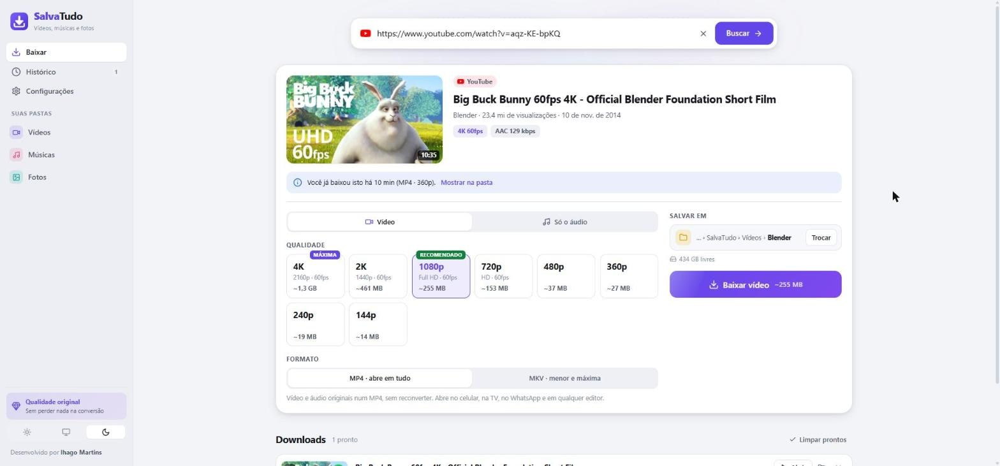
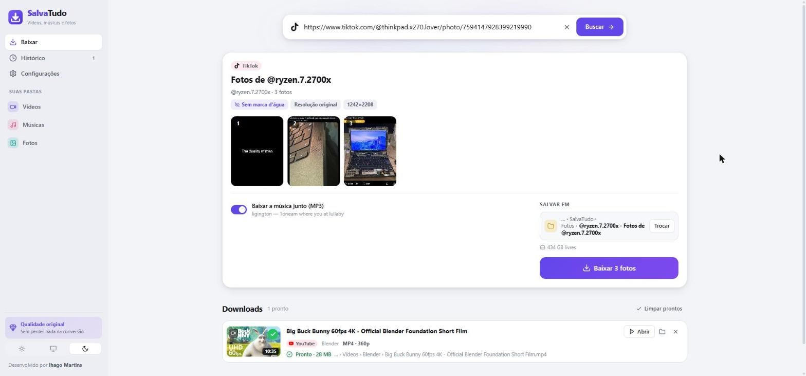

<div align="center">


# SalvaTudo

**Baixe vídeos, músicas e fotos na qualidade original, já organizados em pastas.**

YouTube, Instagram, TikTok, Facebook, X, Pinterest, SoundCloud, Twitch e mais de
1.700 sites. Cole o link, escolha a qualidade e pronto.

[**⬇ Baixar para Windows**](https://github.com/ihagoxd/SalvaTudo/releases/latest)
&nbsp;·&nbsp; [O que faz](#o-que-faz) &nbsp;·&nbsp; [Sites](#sites) &nbsp;·&nbsp; [Desenvolvimento](#desenvolvimento)

[](https://github.com/ihagoxd/SalvaTudo/actions/workflows/testes.yml)
[](LICENSE)


</div>

<picture>
  <source media="(prefers-color-scheme: dark)" srcset="docs/baixar-escuro.jpg">
  
</picture>

## Instalar

1. Baixe o instalador (`SalvaTudo-Instalador-<versão>.exe`) na [página de versões](https://github.com/ihagoxd/SalvaTudo/releases/latest).
2. Rode o instalador. Ele instala só para o seu usuário (não pede senha de
   administrador) e cria os atalhos na área de trabalho e no menu Iniciar.
3. Na primeira vez, o SalvaTudo baixa os dois motores que fazem o trabalho
   pesado (cerca de 100 MB), direto das páginas oficiais, e confere cada arquivo.

> O instalador não tem assinatura digital paga, então na primeira vez o Windows
> pode mostrar "O Windows protegeu o computador". Clique em **Mais informações →
> Executar assim mesmo**.

## O que faz

- **Qualidade original, sem reconverter.** O vídeo e o áudio originais do site
  são só "empacotados" juntos. Antes de baixar você vê todas as qualidades (até
  8K e 60 fps) com o tamanho de cada uma.
  - **MP4** abre em tudo: celular, TV, WhatsApp, editores.
  - **MKV** usa o codec mais moderno (AV1, HDR quando houver): mesma qualidade,
    até metade do tamanho.
- **Música do jeito que você quiser.** Áudio original (sem conversão), M4A, MP3
  320 kbps ou FLAC, com capa de álbum, artista e título gravados no arquivo.
- **Tudo organizado sozinho.** Vídeos por canal, músicas por artista e álbum,
  playlists numeradas na ordem e fotos por perfil. Você escolhe as pastas e o
  jeito de organizar.

  ```
  Downloads\SalvaTudo\
    Vídeos\Nome do canal\Título.mp4
    Músicas\Artista\Álbum\Música.m4a
    Vídeos\Minha playlist\01 - Primeiro.mp4
    Fotos\@perfil\Legenda do post\01.jpg
  ```

- **Fotos do TikTok sem marca d'água.** Posts de fotos e carrosséis saem com
  cada foto no arquivo original, junto com a música do post. As Live Photos
  trazem também o vídeo curto.
- **Vídeos do TikTok sem marca d'água.**
- **Playlists, álbuns e canais inteiros**, com a lista para marcar o que baixar.
  O que você já baixou antes vem desmarcado.
- **Vários links de uma vez.** Cole um por linha, ou só copie o link: ao voltar
  para o SalvaTudo ele já oferece baixar. Dá para arrastar o link do navegador
  para a janela.
- **Fila de downloads** com pausar, continuar (de onde parou, mesmo depois de
  fechar o app), cancelar e tentar de novo. Progresso na barra de tarefas do
  Windows, aviso quando termina e o computador não dorme no meio.
- **Contas conectadas.** Instagram, Facebook, X e outros escondem muitos vídeos
  de quem não está logado. Entre na sua conta uma vez, numa janela do próprio
  SalvaTudo, e esses downloads passam a funcionar. A senha vai direto para o
  site, e nada sai do seu computador.
- **Histórico** com busca: abra, mostre na pasta ou baixe de novo.
- **Sempre atualizado.** Os sites mudam o tempo todo; o motor de download se
  atualiza sozinho uma vez por dia.



## Sites

| | |
|---|---|
| **Vídeo** | YouTube (inclusive Shorts e playlists) · Instagram (Reels e posts) · TikTok · Facebook · X (Twitter) · Pinterest · Twitch (clipes e vídeos) · Kick · Vimeo · Reddit · Dailymotion · Bluesky · LinkedIn · Globo · Rumble e mais 1.700 |
| **Música** | YouTube Music · SoundCloud · Bandcamp · Mixcloud · Audiomack |
| **Fotos** | TikTok (fotos, carrosséis e Live Photos) |

Não dá para baixar de serviços com proteção contra cópia (DRM), como Spotify,
Deezer, Netflix e Prime Video. O SalvaTudo avisa na hora.

> Baixe só o que você tem direito: conteúdo seu, livre ou com permissão de quem fez.

## Privacidade

- Tudo roda no seu computador. O SalvaTudo só fala com o site do link que você
  colou e, para se manter atualizado, com o GitHub (de onde vêm o yt-dlp e o FFmpeg).
- As contas conectadas ficam só neste computador, dentro do app.
- Por padrão o SalvaTudo só aceita conexões do próprio computador, e sites
  abertos no navegador não conseguem mandar ele baixar nada.
- No app instalado, configurações, histórico e componentes ficam em
  `%APPDATA%\SalvaTudo`.

## Atalhos

| Tecla | Ação |
|---|---|
| `Ctrl` + `V` | em qualquer lugar da tela: cola o link e já busca |
| `Enter` | buscar o link |
| `Shift` + `Enter` | nova linha (para colar vários links) |
| `Ctrl` + `L` | selecionar o campo do link |

## Desenvolvimento

Precisa do [Node.js](https://nodejs.org) 22 ou mais novo.

```bash
npm install          # instala as dependências
npm run componentes  # baixa o yt-dlp e o FFmpeg para dados/componentes
npm start            # servidor em http://127.0.0.1:3150
npm run desktop      # o app desktop, como fica depois de instalado
npm run instalador   # gera dist/SalvaTudo-Instalador-<versão>.exe
npm test             # tipos (TypeScript) + testes de ponta a ponta
npm run icones       # regenera os ícones a partir de public/icones/salvatudo.svg
npm run logos        # regenera os logos das redes (Simple Icons)
```

`SALVATUDO_TESTAR_SITES=1 npm test` também testa contra YouTube, TikTok,
SoundCloud e Pinterest de verdade.

Sem instalar nada além do Node.js, o **`SalvaTudo.bat`** prepara tudo e cria um
atalho que abre o app numa janela própria do Edge.

O código é JavaScript puro, sem etapa de build, com os tipos conferidos pelo
TypeScript (JSDoc + `tsc --checkJs`).

```
electron/main.js     app desktop: janela, barra de tarefas, avisos
src/
  server.js          servidor (só aceita a própria janela)
  rotas/api.js       API: analisar, baixar, fila, histórico, configurações
  nucleo/            fila de downloads, histórico, configurações, eventos
  motores/
    ytdlp.js         roda o yt-dlp e acompanha o progresso
    modelos.js       qualidade, formatos e pastas -> argumentos do yt-dlp
    analise.js       resume o que tem no link (qualidades, tamanhos, listas)
    tiktok.js        fotos do TikTok (o yt-dlp não baixa)
    contas.js        contas conectadas (cookies da janela de login)
    componentes.js   baixa e atualiza o yt-dlp e o FFmpeg
public/              interface (Preact + htm, sem build)
test/                testes com um "site" local e vídeos gerados na hora
```

Feito com [yt-dlp](https://github.com/yt-dlp/yt-dlp),
[FFmpeg](https://ffmpeg.org), [Preact](https://preactjs.com),
[Electron](https://www.electronjs.org) e logos do
[Simple Icons](https://simpleicons.org).

## Licença

[MIT](LICENSE) © Ihago Martins

---

<div align="center">

Desenvolvido por **Ihago Martins** — [@ihagomartins1](https://www.instagram.com/ihagomartins1/)

Do mesmo autor: [MeuPDF](https://github.com/ihagoxd/MeuPDF), todas as ferramentas de PDF num app para Windows.

</div>
